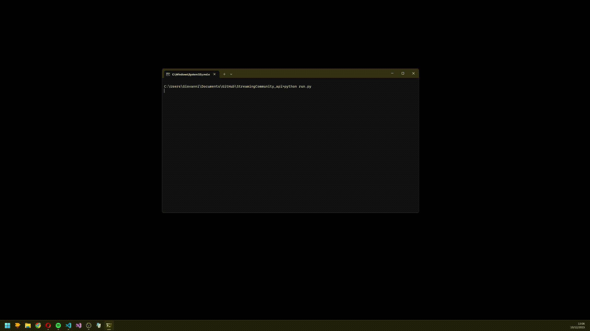

<p align="center">
	
</p>

## Streaming community downloader
<p align="center">
	
</p>

## Overview.
This repository provide a simple script designed to facilitate the downloading of films and series from a popular streaming community platform. The script allows users to download individual films, entire series, or specific episodes, providing a seamless experience for content consumers.

## Requirement
Make sure you have the following prerequisites installed on your system:

* python > [3.11](https://www.python.org/downloads/)
* ffmpeg [win](https://www.gyan.dev/ffmpeg/builds/)

## Installation library
Install the required Python libraries using the following command:
```bash
pip install -r requirements.txt
```

## Usage
Run the script with the following command:
```python
python run.py
```

## Graphic interface
Double click `SC Downloader.bat` (or the shortcut on the desktop), otherwise:
```python
python gui.py
```
It opens in its own window: browse trending titles, search films and series, choose seasons and episodes and follow the download queue with progress. Closing the window closes the program, but only when no download is running. Use `--no-window` to open it in your browser at the printed address, `--port` to change the port.

## Upload to a nas
In the settings, tab NAS, set address, user, password and the folders of the nas: at the end of every download the file is renamed and moved there with SFTP, in the folders used by media servers:
```
Film/X-Men - L'inizio (2011)/X-Men - L'inizio (2011).mp4
Serie TV/Breaking Bad (2008)/Stagione 01/Breaking Bad - S01E03 - Conseguenze radicali.mp4
```
If the nas does not answer the download is never lost: the file stays in `videos` and the queue shows a button to upload it again. The password is saved in the credential manager of the system, address and folders in `nas.json`.

## Use it from the phone
In the settings, tab Telefono, turn on the access from the home network and scan the QR code with the phone (same Wi-Fi, program open on the pc). The phone stays connected, next time open the address shown under the code. Without the key of the QR code nothing is visible, only private addresses are accepted and the settings can be changed only on the pc. "Scollega tutti i telefoni" makes a new key. The first time Windows asks to allow python on the network: choose private networks.

## Auto Update
Keep your script up to date with the latest features by running:
```python
python update.py
```

## Features
- Download Single Film: Easily download individual movies with a simple command.

- Download Specific Episodes or Entire Series: Seamlessly retrieve specific episodes or entire series using intuitive commands. Specify a range of episodes with square brackets notation, e.g., [5-7], or download all episodes with an asterisk (*).

- Download Subtitles: Automatically fetch subtitles if available for downloaded content. (Note: To disable this feature, navigate to ".\Src\Lib\FFmpeg\my_m3u8" and change 'DOWNLOAD_SUB' to False in the configuration file.)

- Sync Audio and Video: Ensure perfect synchronization between audio and video during the download process for an enhanced viewing experience.

## Tutorial
For a detailed walkthrough, refer to the [video tutorial](https://www.youtube.com/watch?v=Ok7hQCgxqLg&ab_channel=Nothing)

## Authors
- [@Ghost6446](https://www.github.com/Ghost6446)
